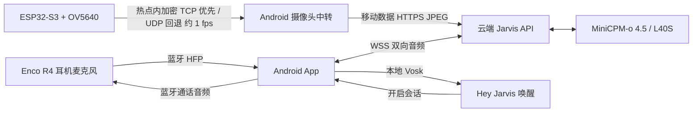

# ESP32 Jarvis 视觉语音助手

ESP32-S3 + OV5640 拍摄画面，手机热点提供网络，云端 MiniCPM-o 4.5 同时理解画面和声音，Android App 将回答送到蓝牙耳机，并在本地监听 **Hey Jarvis**。

**当前 Android 与 ESP32 固件为 v0.2.0 原型版。** 新增热点内加密 TCP / UDP → 手机 HTTPS 中转，避开 ESP32 的公网 TLS 握手；原始画面过期后主动释放。实物 UDP 测试曾复现发送 `errno=12`，现改为优先 TCP、逐帧等待手机确认，UDP 保留兼容回退。正式签名 APK 已在 OPPO 覆盖安装；真实热点的持续收帧记录见 [验证记录](docs/VALIDATION.md)。此前 L40S 上的图像、中文语音和有声回复公网合成测试已通过。

## 下载与上手

- [安卓安装包 jarvis-android-v0.2.0.apk](https://github.com/iapetuszzb/esp32-jarvis/releases/download/v0.2.0/jarvis-android-v0.2.0.apk)
- [ESP32 固件与 Windows 烧录脚本](https://github.com/iapetuszzb/esp32-jarvis/releases/download/v0.2.0/jarvis-esp32s3-firmware.zip)
- [合并固件，首次烧录地址 0x0](https://github.com/iapetuszzb/esp32-jarvis/releases/download/v0.2.0/jarvis-esp32s3-merged.bin)
- [发布页与 SHA256SUMS.txt](https://github.com/iapetuszzb/esp32-jarvis/releases/tag/v0.2.0) · [热点中转与旧帧释放说明](docs/UDP_RELAY.md)
- [逐步安装指南](docs/GETTING_STARTED.md) · [服务端部署](docs/DEPLOY.md) · [协议与系统设计](docs/ARCHITECTURE.md) · [构建方法](docs/BUILD.md) · [验证记录](docs/VALIDATION.md)

APK 支持 Android 8.0+，包含离线唤醒模型，安装后首次启动需解压模型。推荐先在 OPPO 手机前台验证，再开启后台权限。连接密钥、配对码、热点密码和 APK 签名私钥均不随源码发布；当前部署的持有人通过私下提供的连接 JSON 导入。

## 数据流

**v0.2.0 默认通过手机中转画面，仍可选择 ESP32 直接 HTTPS 上传。** 中转接收地址为热点网关，手机端需主动开启“摄像头中转”。手机与摄像头使用相同密钥和设备会话 ID，默认 `jarvis`。ESP32-S3 实际具备 BLE，但本方案不使用它；耳机通话和播放走手机标准蓝牙音频接口，无需逆向 OPPO 私有协议。

## 当前功能

- 摄像头：VGA JPEG 约 1 fps，热点内 AES-GCM TCP / UDP 中转或证书校验 HTTPS 直传，断线重连，SoftAP 网页/App 配网，BOOT 长按重新配网。
- 手机：离线 Hey Jarvis，手动开始/结束，HFP 优先路由，明确显示手机麦克风回退，中文文字看图提问和语音播放。
- 模型：真实全双工图像+音频输入、24 kHz 语音输出；不额外串联 ASR、LLM 和 TTS。单张图文字接口作为调试入口。
- 服务：单 GPU 会话、最新画面缓存、超过 4 秒主动释放像素、音频队列限流、一次性配对码与 Bearer 鉴权。
- 持续观察：开启后直接进入会话，允许模型主动提醒；它不是可靠事件检测器，也不保证只在你提问时开口。

每轮云端会话最长 10 分钟；普通模式连续约 60 秒未检测到说话会返回唤醒状态，持续观察模式不使用该手机端静音超时。6 小时麦克风唤醒锁到期后需重新开启监听。当前没有自动跨会话记忆、可靠打断播报、自动重连或多用户并发调度。

## 硬件配置

固件依据用户开发板原始示例中的 `CAMERA_MODEL_ESP32S3_EYE` 配置，使用 8 MB Flash 分区布局、OPI PSRAM、XCLK 15 MHz。实际连接板已读出 16 MB Flash 和 8 MB PSRAM，当前分区只使用 Flash 的前 8 MB。不要把板型名字当成所有 ESP32-S3 的统一接线。

| 信号 | GPIO | 信号 | GPIO |
|---|---:|---|---:|
| XCLK | 15 | SCCB SDA / SCL | 4 / 5 |
| D0 / D1 | 11 / 9 | D2 / D3 | 8 / 10 |
| D4 / D5 | 12 / 18 | D6 / D7 | 17 / 16 |
| VSYNC / HREF | 6 / 7 | PCLK | 13 |
| PWDN / RESET | 未接 / -1 | BOOT 配网 | 0 |

GPIO 定义位于 [camera_pins.h](firmware/include/camera_pins.h)。启动日志会报告实际 PSRAM 容量和摄像头 PID。没有 PSRAM 时降为 QVGA，但 OPI PSRAM 设置仍需与实际板卡匹配。

## 可以借鉴的开源项目

| 项目 | 本工程的参考方式 |
|---|---|
| [OpenBMB/MiniCPM-V](https://github.com/OpenBMB/MiniCPM-V) / [MiniCPM-o-4_5 模型](https://huggingface.co/openbmb/MiniCPM-o-4_5) | 图像、语音、全双工推理 API；使用模型自带参考音色与滑动窗口 |
| [78/xiaozhi-esp32](https://github.com/78/xiaozhi-esp32) | ESP32 语音设备的产品流程参考；本工程没有复制其设备协议或移植其固件 |
| [espressif/esp32-camera](https://github.com/espressif/esp32-camera) | Arduino ESP32 摄像头驱动，支持 OV5640 JPEG |
| [alphacep/vosk-api](https://github.com/alphacep/vosk-api) | Android 本地唤醒关键词识别 |

本工程源码采用 MIT；依赖库、唤醒模型和 MiniCPM 权重各自保留其许可，见 [THIRD_PARTY_NOTICES.md](THIRD_PARTY_NOTICES.md)。
